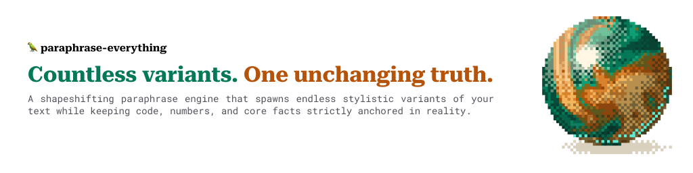

  

# paraphrase-everything

A paraphrase skill for AI agents (Claude Code, Codex, and more) that rewrites any text in any tone (formal, casual, academic, plain language, or playful personas) while keeping code, numbers, names, and core facts exactly as they were.

LLMs are good at rewriting but unreliable at staying faithful: they drift in meaning, change figures, break formatting, and lose consistency on long documents. **paraphrase-everything** pairs the model's writing with deterministic tooling that protects what must not change, checks fidelity against the original, and measures how much was actually rewritten.

## Installation

🚧 Coming soon.

## Usage

🚧 Coming soon.

## Documentation

🚧 Coming soon.

## Star History

<a href="https://star-history.com/#ngwgsang/paraphrase-everything&Date">
  <picture>
    <source media="(prefers-color-scheme: dark)" srcset="https://api.star-history.com/svg?repos=ngwgsang/paraphrase-everything&type=Date&theme=dark" />
    <source media="(prefers-color-scheme: light)" srcset="https://api.star-history.com/svg?repos=ngwgsang/paraphrase-everything&type=Date" />
    
  </picture>
</a>

## Disclaimer

- This project is under early development. Features described above may be incomplete or change without notice.
- Paraphrased output is generated by AI models and may contain errors. Automated checks reduce, but do not eliminate, the risk of altered meaning. Always review the result before publishing or relying on it, especially for legal, medical, financial, or academic content.
- This tool is meant to improve clarity, tone, and readability. It is not intended to disguise plagiarism, evade AI-content detectors, or violate academic integrity policies. Respect copyright and cite your sources.
- You are responsible for the content you process and how you use the output.

## Contributing

Contributions are welcome! The contribution guide is coming soon. Until then:

- **Bugs and ideas:** open an [issue](https://github.com/ngwgsang/paraphrase-everything/issues).
- **New language packs or personas:** open an issue first so we can agree on the scope.
- **Pull requests:** keep them focused, include tests where relevant, and describe what changed and why.

Thanks to all our contributors:

Made with [contrib.rocks](https://contrib.rocks).

## License

Released under the [MIT License](LICENSE).
